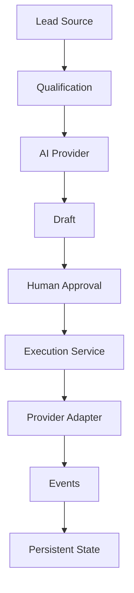

# Agentic Outreach Reference Implementation

Human-controlled, AI-assisted outbound workflow — a sanitized reference for reusable orchestration, state-management, and provider-adapter patterns.

This is technical proof of capability, not a commercial product. There is no pricing, no customer accounts, and no SaaS positioning.

---

## 1. What This Demonstrates

A stateful outbound pipeline:

```text
Sample Lead
    → Qualification
    → AI Analysis
    → Outreach Draft
    → Human Review
    → Approve / Reject / Hold
    → Controlled Execution
    → Mock Delivery
    → Provider Event / Response
    → Updated Persistent State
```

The demonstration is architectural:

1. AI assists with analysis and content generation.
2. AI does not directly control external side effects.
3. Lead lifecycle state is explicit and persistent.
4. Human approval is required before outreach.
5. Approval and execution are separate operations.
6. Sending is isolated behind a provider/service boundary.
7. Failed actions do not falsely advance lifecycle state.
8. External actions and state transitions are logged.
9. Suppression and duplicate-send protection block unsafe actions.
10. External systems are represented through replaceable adapters.

---

## 2. What It Does Not Demonstrate

- It is not a deployed client system.
- It does not send real email.
- It does not scrape real prospects.
- It does not contain private internal tooling, prompts, datasets, or credentials.
- It does not claim production integrations that are not implemented.
- There is no authentication, billing, multi-tenancy, or CRM product surface.

This repository is a sanitized reference implementation demonstrating reusable workflow, orchestration, state-management, and integration patterns. It contains fictional data and does not represent a deployed client system.

---

## 3. Architecture



| Module | Responsibility |
| --- | --- |
| `src/outreach/models.ts` | Lead, event, and lifecycle types |
| `src/outreach/lifecycle.ts` | Allowed state transitions |
| `src/outreach/qualification.ts` | Deterministic scoring |
| `src/outreach/ai.ts` | `AIProvider` interface and `MockAIProvider` |
| `src/outreach/email.ts` | Delivery interface and `MockEmailProvider` |
| `src/outreach/engine.ts` | Approval, eligibility, execution, inbound events |
| `src/outreach/seed.ts` | Fictional demo companies |
| `src/outreach/store.ts` | Persistent demo state |
| `src/components/dashboard.tsx` | Operator dashboard |

Two hard boundaries:

**Deterministic application logic** owns lifecycle, eligibility, qualification rules, approval, execution authorization, duplicate protection, suppression, limits, and event recording.

**AI / provider layer** owns diagnosis, recommendations, content generation, and simulated delivery. AI output never authorizes an external action.

---

## 4. Lifecycle

```text
Discovered → Qualified → Analyzed → DraftGenerated
                                      ↓
                         Approved | Rejected | Held
                                      ↓
                         Held → Approved | Rejected
                                      ↓
                         Approved → Sent | Failed
                                      ↓
                         Sent → Replied
```

The UI does not write `lead.status` directly. Application functions call `transition()`, which rejects illegal jumps.

Inbound bounce and unsubscribe after a successful send suppress the recipient without pretending the original send did not happen.

---

## 5. Control Boundaries

**Why AI cannot send directly.** `MockAIProvider` returns diagnosis text and a draft string. It has no reference to the email adapter and no lifecycle mutator.

**Why approval and execution are separate.** `approveLead` requires a valid recipient and moves the lead to `Approved`. It never calls `EmailProvider.send`. `executeApproved` is a second operator action.

**Why provider success controls advancement.** Only a delivery result of `sent` increments `send_count` and moves the lead to `Sent`. `failed` and `bounced` are recorded; they do not mark the lead as contacted.

**Duplicate protection.** The execution layer refuses any lead whose `send_count !== 0`, even if a caller tampers with status. Hiding a button is not the control.

**Suppression.** Bounce and unsubscribe add the normalized address to a suppression list. Execution checks that list before calling the provider.

**Limits.** A configurable daily quota (default 5) counts only successful mock sends. Failed attempts do not consume it.

---

## 6. Provider Adapters

```text
Application
     ↓
AI Provider Interface
     ↓
MockAIProvider
```

```text
Execution service
     ↓
Email Provider Interface
     ↓
MockEmailProvider
```

A production implementation could replace `MockAIProvider` with a Claude-backed adapter while preserving the application's control boundary.

The generic CRM/provider boundary could be implemented against GoHighLevel or another CRM without moving lifecycle authority into the AI layer.

Those replacements are not implemented here. The adapters exist so the application does not hard-code a vendor.

**Forced mock outcomes** (no real mail):

| Recipient | Result |
| --- | --- |
| `name@example.com` | `sent` |
| `name+fail@example.com` | `failed` |
| `name+bounce@example.com` | `bounced` |

---

## 7. Local Setup

This reference runs as a TypeScript web application so a reviewer can exercise the full path in a browser. Domain logic is framework-agnostic and unit-tested without the UI.

```bash
git clone <repository-url>
cd agentic-outreach-reference
npm install
npm test
npm run dev
```

Open the printed local URL. No paid APIs, cloud accounts, or Docker are required. Demo state persists in the browser; **Reset demo** restores the fictional seed.

---

## 8. Demo Walkthrough

1. Reset demo.
2. Inspect fictional leads.
3. Run qualification / analysis.
4. Review diagnosis and generated message.
5. Add a fictional recipient.
6. Approve the lead.
7. Observe that nothing was sent (`send_count` remains 0, no `send_succeeded` event).
8. Execute approved leads.
9. Inspect the resulting event.
10. Simulate reply / bounce / unsubscribe.
11. Inspect lifecycle and suppression changes.

Willowbrook Book Circle is an intentional low-score control so scoring is inspectable, not theatrical.

---

## 9. Integration Mapping

Conceptual only — none of the following are implemented:

| Boundary | Could be replaced by |
| --- | --- |
| `MockAIProvider` | Claude, an OpenAI-compatible model, or a local model |
| `MockEmailProvider` | A transactional mail adapter such as Resend |
| Lead source | A CRM adapter (GoHighLevel, HubSpot, Salesforce) or an enrichment tool (Apollo, Clay) |

---

## Tests

Behavioral invariants live in `src/outreach/engine.test.ts`:

1. Unapproved leads cannot send.
2. Approval itself does not send.
3. Missing recipient blocks approval.
4. Rejected leads cannot send.
5. Held leads cannot send.
6. Failed delivery does not transition to Sent.
7. Successful delivery increments send count.
8. Successfully sent lead cannot send twice.
9. Suppressed recipient cannot send.
10. Bounce suppresses recipient.
11. Unsubscribe suppresses recipient.
12. Reply updates lifecycle state.
13. Daily limit prevents additional execution.
14. Failed attempts do not consume successful-send quota.

```bash
npm test
```

---

## Known Limitations

- Delivery and AI providers are deterministic mocks. No network calls are made.
- Persistence is browser-local so Reset demo cannot wipe another reviewer's session.
- There is no authentication, because this is a reference, not a multi-user product.
- Daily quota uses UTC day boundaries.
